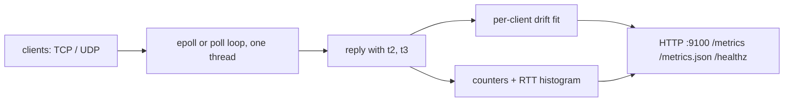

# TimeSyncD

An NTP-style time server in C for Linux and macOS. Clients exchange four timestamps with it (TCP or UDP), compute offset and delay, and discipline a simulated drifting clock; the server runs a single `epoll` loop (with a `poll()` fallback), tracks every client's clock drift, and exposes latency and drift as Prometheus text and JSON.



Design, trade-offs and failure modes: [docs/DESIGN.md](docs/DESIGN.md).

## Quickstart

```bash
make                                              # builds server_bin, client_bin, loadgen, tests (-Wall -Wextra -Werror)
./server_bin --config deploy/timesyncd.conf       # TCP :9000, metrics :9100
./client_bin --mode tcp --server-ip 127.0.0.1 --port 9000   # in another terminal; curl localhost:9100/metrics.json
```

Docker: `docker compose up --build` (image runs as an unprivileged user with a health check). systemd: `deploy/timesyncd.service` and `deploy/timesyncd.conf`.

## What it does

- **Server**: non-blocking sockets, epoll on Linux and poll() elsewhere or by choice (`backend = auto|epoll|poll`), dynamic client table (no `FD_SETSIZE` cap), per-connection frame reassembly and bounded output queues, idle expiry, accept back-off on `EMFILE`, graceful shutdown (listeners close, queued replies flush for up to `drain_ms`).
- **Offset and delay** (client side): `offset = ((t2-t1)+(t3-t4))/2`, `delay = (t4-t1)-(t3-t2)`, with a sliding-window least-squares discipline that rejects high-delay samples.
- **Per-client drift tracking** (unique feature): the server fits each client's offset against the client's own clock and reports drift in ppm; `/metrics` carries p50/p99/max of |drift| across clients and `/metrics.json` the top-N clients with offset and sample counts. Tested against clocks with known drift.
- **Metrics**: Prometheus text (`/metrics`), JSON (`/metrics.json`), `/healthz`, plus the optional POSIX shared-memory block read by `metrics_reader`.
- **Config**: `key = value` file with CLI overrides.

## Results

All numbers below come from the `loadtest` CI job on a GitHub-hosted runner, loopback, load generator and server on the same machine. The load generator is a single thread, so its own scheduling is part of the measured round trip; treat percentiles as an upper bound for the server alone. Nothing here is a claim about real networks.

@@RESULTS@@

## Tests and CI

`make test` runs 455 unit checks (wire format, NTP math, discipline, drift estimator, config parser) and the integration suite twice (default backend and forced `poll`): TCP and UDP clients converging against a real server, byte-at-a-time framing, garbage input, idle expiry, 1,500 concurrent connections, slow-reader eviction, metrics endpoint, drift against known clock drift, graceful stop. CI (Ubuntu and macOS): build with `-Werror`, tests, ASAN/UBSAN/TSAN, Docker build + health check + SIGTERM exit code, CodeQL, and the load test.

## Limitations

- No authentication or encryption, plain-HTTP metrics: keep both on a private network.
- Single thread: one core is the ceiling; see the scaling path in the design doc.
- Drift is estimated from the client's reported clock and assumes a symmetric path; clients that correct their clock before stamping `t1` will look drift-free.
- Clients are simulated (skew and drift are injected in software); there is no hardware clock discipline.
- On macOS only the `poll()` backend is available.
