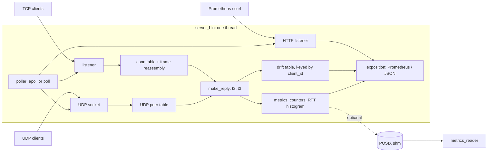
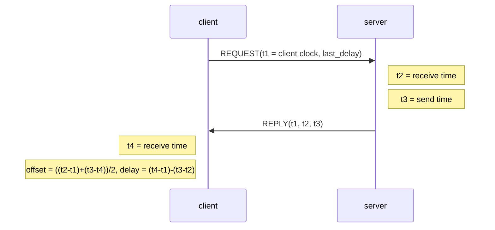

# TimeSyncD design

## Problem

Clients need to estimate their clock offset from a reference and the operator needs to see which clients drift. TimeSyncD is a small NTP-style time server: clients exchange four timestamps with it, compute offset and delay, and discipline their clocks; the server tracks how many clients it serves, round-trip latency and each client's clock drift. It is a teaching/portfolio daemon, not a replacement for chrony or ntpd (no authentication, no stratum hierarchy, no leap-second handling).

## Requirements

Functional
- Answer timestamped requests over TCP (length-prefixed frames) or UDP (one frame per datagram).
- Offset and delay by the NTP four-timestamp formulas.
- Per-client drift estimate, exposed with latency and counters as Prometheus text and JSON.
- Config file plus CLI overrides; graceful shutdown on SIGTERM/SIGINT.

Non-functional
- One thread, non-blocking sockets, no per-client thread; the limits are file descriptors and memory.
- No lock held across I/O; a slow or silent client must not stall others.
- Bounded memory per client (fixed frame buffer, 352-byte output queue, fixed-size drift record) and a hard cap on drift records.
- Free to run: GitHub Actions, GHCR-compatible Docker image, no external services.

## Architecture

Request sequence (TCP):

Components: `server/poller.c` (epoll with a poll() fallback behind one interface, both level-triggered), `server/server_core.c` (loop, connections, HTTP, drain), `server/drift.c`, `server/exposition.c`, `server/config.c`, `common/protocol.c` (wire format and framing), `common/ntp.c` (offset/delay and the client-side discipline), `tools/loadgen.c` and `tools/loadtest.py`.

## Data model

- Frame: `u32 length | type, version, reserved | client_id | seq | t1 | t2 | t3 | last_delay_ns`, big-endian, 44-byte payload (up to 64 accepted).
- Connection (TCP): fd, frame reassembly buffer, 8-frame output queue, last-seen time, interest flags.
- UDP peer: address, last-seen, kept in an open-addressing table that grows and is rebuilt on expiry.
- Drift record per `client_id`: first sample, and a recency-weighted least-squares state (weight, means, Sxx, Sxy; 0.98 decay per sample). The fitted slope of offset versus client time is the drift.
- Telemetry block: counters, min/max/Welford over client-reported latency, 11-bucket RTT histogram.

## Interfaces

HTTP (separate port, default 9100, `metrics = off` to disable):

| Endpoint | Content |
|---|---|
| `GET /healthz` | `200 ok` while the loop is serving |
| `GET /metrics` | Prometheus text: clients, requests/accepted/rejected/expired/protocol-error counters, RTT histogram, drift gauges (tracked, ready, |drift| p50/p99/max), `timesyncd_info{backend,mode}` |
| `GET /metrics.json` | the same plus the top-N clients by |drift| (`drift_top`) with offset and sample count |

Per-client series are deliberately not exported to Prometheus (label cardinality); the JSON endpoint carries the top-N.

Config keys (file or `--key value`): `mode port backend idle_sec max_clients backlog metrics metrics_port drift_max_clients drift_top sndbuf drain_ms shm`.

## Drift estimation

Each request carries the client's raw clock reading `t1` and its previous round-trip delay. The server forms `offset = (t2 - t1) - last_delay/2` and fits it against `t1`. A client clock that is fast by `d` ppm makes this offset shrink by `d` microseconds per second, so `drift_ppm = -slope * 1e6` (positive means the client is fast). An estimate is reported once 8 samples span at least 2 s. The estimate assumes a symmetric path; asymmetry biases the offset but, being roughly constant, hardly changes the slope. A client that disciplines its own clock before stamping `t1` will look drift-free: the server measures what the client reports.

## Scaling path

Single thread is enough for the tested range because each request is a few hundred nanoseconds of work plus two syscalls. The next steps, in order: `SO_REUSEPORT` with one loop per core (the drift table then needs sharding by `client_id`), `recvmmsg`/`sendmmsg` for UDP, `EPOLLEXCLUSIVE` for the listener. The 20,000-client ceiling in the CI test comes from the ephemeral port range of one loopback address pair, not from the server.

## Failure modes and mitigations

| Failure | Behaviour |
|---|---|
| fd exhaustion (`EMFILE`) | accept pauses 100 ms (the pending connection stays queued), `accept_errors` counted |
| client stops reading | replies queue (8 frames), then the connection is dropped; tested |
| malformed frame / bad length | one connection closed, `protocol_errors` counted, others unaffected |
| silent client | expired after `idle_sec`; HTTP connections after 5 s |
| drift table full | new clients untracked, `drift_clients_dropped_total` rises; existing ones unaffected |
| SIGTERM | listeners close, queued replies get up to `drain_ms`, exit code 0 |
| `epoll` unavailable (non-Linux) | `backend = auto` falls back to `poll()`; `backend = epoll` fails at start |

## Security and privacy

No authentication and no encryption: anyone who can reach the port can query and, in TCP mode, hold a connection. Do not expose it to the internet. Mitigations built in: bounded buffers, per-connection memory cap, `max_clients`, idle expiry, the container runs as an unprivileged user with a read-only root and dropped capabilities, the systemd unit uses `DynamicUser` and a restricted sandbox. The metrics endpoint is unauthenticated and plain HTTP; bind it to a private network or put it behind a proxy. Client ids are self-reported and can be spoofed, so drift records are advisory.

## Decisions

- ADR-1 epoll behind a poller interface, `poll()` kept as a first-class backend: portable (macOS), and a baseline to compare against in CI. Level-triggered keeps partial reads and write queues simple; edge-triggered would need drain-until-EAGAIN discipline everywhere for little gain at this scale.
- ADR-2 one thread: avoids locking the client table and the drift table; the cost is a single-core ceiling.
- ADR-3 server-side drift from `t1`/`t2` instead of asking clients to report offsets: works with unmodified requests, at the price of assuming path symmetry.
- ADR-4 recency-weighted regression (0.98 decay) over a fixed window: O(1) state per client and follows slow changes in frequency.
- ADR-5 histogram of client-reported RTT instead of server-side service time: the interesting latency is end-to-end; the server cannot see it, clients tell it.
- ADR-6 key=value config over JSON/TOML: no dependency, trivially parsed in C.

## Cost (free tier)

| Item | Where | Cost |
|---|---|---|
| CI, load test | GitHub Actions public-repo runners | free |
| Image registry | GHCR (not published by this PR) | free for public images |
| Monitoring | any Prometheus/Grafana you already run, or `curl` | free |
| Hosting | any Linux box with systemd or Docker | your own |
